<picture>
  <source media="(prefers-color-scheme: dark)" srcset="header-dark.svg">
  
</picture>

<picture>
  <source media="(prefers-color-scheme: dark)" srcset="experiencia-dark.svg">
  
</picture>

<a href="https://postulamejor.com.ar">
  <picture>
    <source media="(prefers-color-scheme: dark)" srcset="proyecto-postula-mejor-dark.svg">
    
  </picture>
</a>

<a href="https://github.com/cinosores/Clariz-Viste">
  <picture>
    <source media="(prefers-color-scheme: dark)" srcset="proyecto-gestion-textil-dark.svg">
    
  </picture>
</a>

<picture>
  <source media="(prefers-color-scheme: dark)" srcset="stack-dark.svg">
  
</picture>

<a href="https://www.linkedin.com/in/cintiaosores">
  <picture>
    <source media="(prefers-color-scheme: dark)" srcset="cta-dark.svg">
    
  </picture>
</a>
&nbsp; o escribime a [noeliaosores@gmail.com](mailto:noeliaosores@gmail.com)
