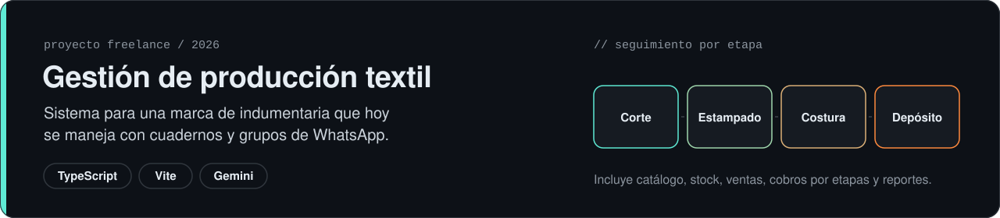
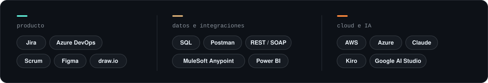

  

Trabajo entre el negocio y los equipos técnicos: relevo, priorizo el backlog, escribo especificaciones que se pueden desarrollar sin adivinar y valido que lo entregado resuelva el problema real. Hoy lo hago en aplicaciones críticas del sector **Oil & Gas (upstream)**, coordinando proveedores externos y equipos de desarrollo.

Este GitHub es mi espacio para **prototipos y productos propios hechos con IA**: los uso para probar ideas rápido y llegar a la reunión con algo navegable en lugar de un documento.

  

### Qué hago

- **Producto:** roadmap, backlog, criterios de aceptación, UAT y gestión de stakeholders.
- **Análisis funcional:** relevamiento de procesos, especificaciones funcionales, flujos y BPMN.
- **Integraciones y datos:** APIs REST/SOAP, SQL y migración de integraciones a MuleSoft Anypoint.
- **IA aplicada:** prototipos con Google AI Studio, Claude y AWS Kiro, y especificaciones pensadas para desarrollo asistido por IA.

### Proyectos

### Herramientas

  

### Formación

- **CSPO**, Certified Scrum Product Owner (Scrum Alliance)
- Consultor en IA, UTN
- Licenciatura en Administración de Empresas, FAEC (en curso)
- En preparación: AWS Certified Cloud Practitioner

  
  

